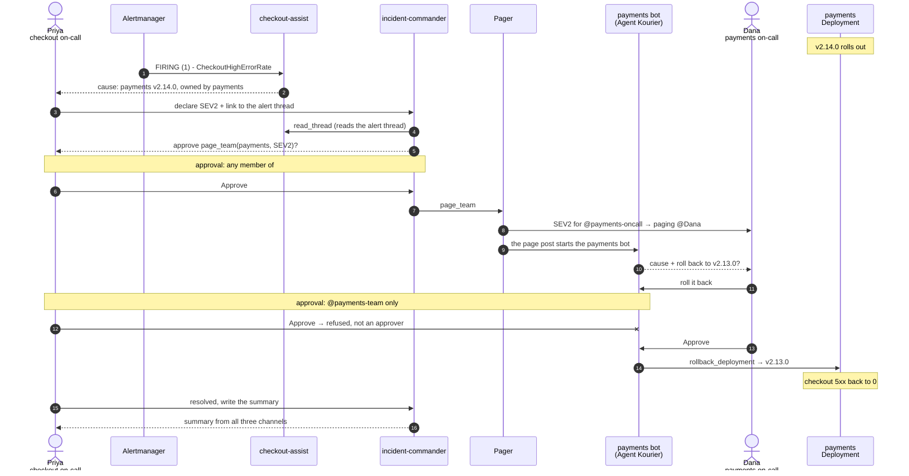

# kourier-incident-demo

A cross-team incident run end to end in Slack by three [Agent Kourier](https://github.com/agentkourier/agent-kourier)
bots and their kagent agents. The payments team ships
[demo-payments](https://github.com/agentkourier/demo-payments) v2.14.0, which turns the `amount` of its authorize
response from integer cents into a decimal string. [demo-checkout](https://github.com/agentkourier/demo-checkout)
decodes `amount` as `int64`, so every response from v2.14.0 fails in checkout while payments keeps returning 200.

| Bot | Channel | Agent | Starts on | Can change |
|---|---|---|---|---|
| checkout-assist | `#checkout-alerts` | `checkout-sre` | Alertmanager's `CheckoutHighErrorRate` post, or a mention | nothing |
| incident-commander | `#incidents` | `incident-commander` | a mention | posts a page through the Pager app, after a person approves |
| Agent Kourier (payments) | `#payments-ops` | `payments-sre` | the Pager's page, or a mention | rolls payments back, after a member of the payments user group approves |

## How the incident plays out

Three people take part. The two Slack user groups are what the page mentions and what the rollback approval checks.

| Person | Role | User groups |
|---|---|---|
| Priya | checkout on-call: gets the alert, declares the incident, approves the page | none |
| Dana | payments primary on-call: gets paged, asks for the rollback, approves it | `@payments-oncall`, `@payments-team` |
| Lee | payments secondary on-call: named in the page's escalation line | `@payments-team` |

The agents read freely. The two actions that change something wait for a person, and Agent Kourier, not the prompt,
decides who that person can be:

- **`page_team`** (incident-commander, `#incidents`): any member of `#incidents` can approve.
- **`rollback_deployment`** (payments bot, `#payments-ops`): only `@payments-team` can approve. Anyone else's press is
  refused with "Only approvers of this Binding can decide this request." and audited.



`read_thread` reads Slack's history of `#checkout-alerts`; it isn't a message to checkout-assist. In a full run on
this setup, checkout recovered about three minutes after the rollback.

## Where it runs

It runs on agent-kourier's kind **full tier** (kagent 1.0.0-alpha5 on Agent Substrate, Dex, the verifying front
door), with the tier's sandbox overlay for the model (`make sandbox-up` in an agent-kourier checkout).

## Layout

```
catalog/          Backstage-style catalog: Components, Groups and the payments API
mcp/              MCP servers (catalog, pager, rollout, slackread) and their manifests; GitHub and Grafana MCP manifests
observability/    Prometheus, Tempo, OTel collector, Grafana, the alert rule and the Alertmanager route
loadgen/          load generator for checkout
agents/           the three kagent agents and their system prompts
deploy/commerce/  payments, checkout
deploy/kourier/   the three Agent Kourier releases: config, Helm values, install and down scripts
scripts/          rollout, reset, heal
```

## Before `make up`

- The kind full tier with the sandbox overlay is up, and agent-kourier's `agent-kourier:dev` image is loaded.
  `AGENT_KOURIER_CHECKOUT` points at that checkout (default `../agent-courier`), for the Helm chart.
- Images built and loaded into kind: `demo-payments:v2.13.0`, `demo-payments:v2.14.0` and `demo-checkout:v1.8.0`
  (`make image VERSION=…` in the service repos at their tags), then `make images` here.
- Three more Slack apps besides the sandbox's: checkout-assist and incident-commander (Socket Mode, the sandbox
  app's scopes), and Pager (`chat:write`, `chat:write.public`). Their tokens are in
  `~/.config/agent-kourier/demo-checkout-assist.env`, `demo-incident-commander.env` (`SLACK_BOT_TOKEN`,
  `SLACK_APP_TOKEN`) and `demo-pager.env` (`SLACK_BOT_TOKEN`), mode 600.
- Slack channels and members. `#checkout-alerts`: Priya, checkout-assist. `#incidents`: everyone, incident-commander.
  `#payments-ops`: Priya, Dana, Lee, the payments bot. incident-commander must also be a member of `#checkout-alerts`
  and `#payments-ops`, or `read_thread` and `read_recent` fail with `not_in_channel` and it can't see what the other
  agents found; its Binding still listens only in `#incidents`. Pager needs no membership (`chat:write.public`).
  User groups `@payments-oncall` (Dana) and `@payments-team` (Dana, Lee).
- Workspace IDs, which are not committed: `catalog/slack-ids.yaml` (from `slack-ids.example.yaml`) and
  `deploy/kourier/ids.env` (from `ids.example.env`). Load the first and the two bot tokens as Secrets in
  `demo-tools`; see the comment at the top of `mcp/deploy/kustomization.yaml`.
- For Alertmanager to post to `#checkout-alerts`: an incoming-webhook URL in
  `~/.config/agent-kourier/demo-checkout-alerts-webhook-url`, then `observability/install.sh` again.

## Running it

```sh
make up            # observability, tools, agents, commerce, the three releases
make rollout-bad   # payments v2.14.0: checkout fails, CheckoutHighErrorRate fires about 2 minutes later
make reset         # payments back on v2.13.0 with a clean history, between takes
make down          # remove the demo and give the payments Slack app back to the sandbox release
make heal          # after a Docker or node restart, if every agent turn says "input was not accepted"
```

`make kourier` scales the tier's `agent-kourier-sandbox` release to 0, because the payments bot is the sandbox's
Slack app and two Socket Mode connections on one app split its events. `make down` scales it back to 1.

The GitHub MCP server is deployed at zero replicas. To let the payments agent read the diff, put a read-only token
for the two service repos in Secret `kagent/demo-github-token` (key `token`, value `Bearer <token>`), scale
`demo-tools/github-mcp` to 1, and bind `github-mcp` in `agents/agents.yaml`.
