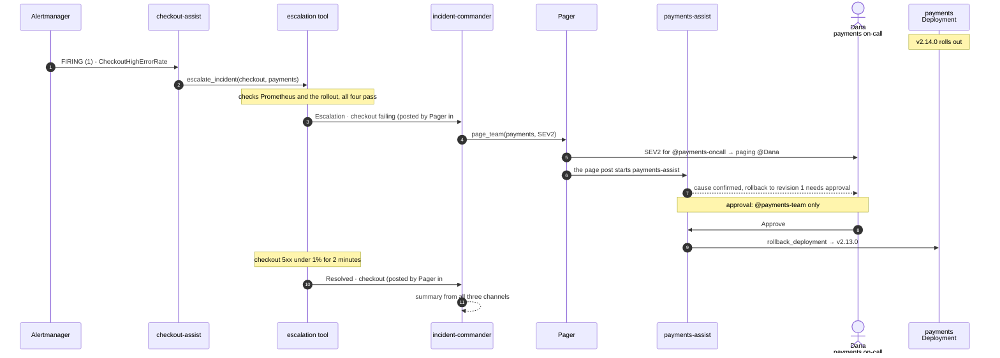

# kourier-incident-demo

A cross-team incident run end to end in Slack by three [Agent Kourier](https://github.com/agentkourier/agent-kourier)
bots and their kagent agents. The payments team ships
[demo-payments](https://github.com/agentkourier/demo-payments) v2.14.0, which turns the `amount` of its authorize
response from integer cents into a decimal string. [demo-checkout](https://github.com/agentkourier/demo-checkout)
decodes `amount` as `int64`, so every response from v2.14.0 fails in checkout while payments keeps returning 200.

| Bot | Channel | Agent | Starts on | Does without a person | Waits for a person |
|---|---|---|---|---|---|
| checkout-assist | `#checkout-alerts` | `checkout-sre` | Alertmanager's `CheckoutHighErrorRate` post, or a mention | investigates; escalates to `#incidents` when the escalation tool's evidence check passes, or asks the checkout on-call | nothing |
| incident-commander | `#incidents` | `incident-commander` | Pager's escalation or resolved post, or a mention | declares the incident, pages the owning team, writes the summary | nothing |
| payments-assist | `#payments-ops` | `payments-sre` | the Pager's page, or a mention | confirms the cause, proposes the rollback | the rollback: a member of the payments user group approves |

## How the incident plays out

The agents run the hand-off between teams. A person is needed for one routine step, approving the rollback of
production, and is pulled in earlier only when an agent can't attribute the cause.

| Person | Role | User groups |
|---|---|---|
| Priya | checkout on-call: sees the alert and the agents' work; asked for help if the cause can't be confirmed | none |
| Dana | payments primary on-call: paged, approves the rollback | `@payments-oncall`, `@payments-team` |
| Lee | payments secondary on-call: named in the page's escalation line, can approve the rollback | `@payments-team` |

### Who decides the agent is sure

Not the model. `escalate_incident` re-checks the evidence itself with Prometheus and Kubernetes and posts to
`#incidents` only when every check passes:

1. the impacted service's 5xx ratio is above 5%;
2. the suspected service rolled out a new ReplicaSet within 15 minutes before the errors began;
3. the impacted service's calls to the suspected service fail above 50%;
4. the suspected service's own 5xx ratio is under 5%.

It returns each check with what it measured, and has a `dry_run`. When a check fails, checkout-assist calls
`ask_oncall`, which replies in the alert thread and mentions the checkout on-call with what it checked and ruled
out. The alert text an agent reads is untrusted, so a crafted annotation can't talk an agent into escalating. These
thresholds are this demo's policy, and the third check only knows the checkout → payments client metric.

### The one approval

**`rollback_deployment`** (payments-assist, `#payments-ops`): only `@payments-team` can approve, and Agent Kourier, not
the prompt, enforces it. Anyone else's press is refused with "Only approvers of this Binding can decide this
request." and audited. incident-commander's Binding has approvals off, so any approval request from it is denied.



If the evidence check fails, the chain stops at step 3: `ask_oncall` replies in the alert thread mentioning the
checkout on-call, and a person can still declare by mentioning incident-commander in `#incidents`.

In a run on this setup the hand-off took about 30 seconds: the alert posted at 20:56:27 UTC, and the rollback
proposal was waiting for approval at 20:57:02.

## Where it runs

It runs on agent-kourier's kind **full tier** (kagent 1.0.0-alpha5 on Agent Substrate, Dex, the verifying front
door), with the tier's sandbox overlay for the model (`make sandbox-up` in an agent-kourier checkout).

## Layout

```
catalog/          Backstage-style catalog: Components, Groups and the payments API
mcp/              the MCP servers: one folder per in-house server (code, cmd, deploy/), upstream/ for GitHub and Grafana
observability/    Prometheus, Tempo, OTel collector, Grafana, the alert rule and the Alertmanager route
loadgen/          load generator for checkout
agents/           the three kagent agents and their system prompts
deploy/commerce/  payments, checkout
deploy/kourier/   the three Agent Kourier releases: config, Helm values, install and down scripts
scripts/          rollout, reset, heal
```

## MCP servers

The agents reach everything through MCP servers. Each agent is offered only the tools `agents/agents.yaml` lists for
it (kagent's filter on each `tools` entry). The demo deploys seven, each with its own Deployment in `demo-tools` and `RemoteMCPServer` in `kagent`;
`sandbox-tools` comes with the tier's sandbox overlay.

| Server | Code | Agents and tools | What it can reach |
|---|---|---|---|
| `catalog-mcp` | [`mcp/catalog`](mcp/catalog) | all three: `lookup_service`; checkout-sre and incident-commander also `list_services` | the catalog ConfigMap, read-only |
| `escalation-mcp` | [`mcp/escalation`](mcp/escalation) | checkout-sre: `escalate_incident`, `ask_oncall` | Prometheus; Deployments and ReplicaSets in `commerce`, read-only; posts to Slack as Pager |
| `pager-mcp` | [`mcp/pager`](mcp/pager) | incident-commander: `page_team` | posts to Slack as Pager, one page per team every 10 minutes |
| `rollout-mcp` | [`mcp/rollout`](mcp/rollout) | payments-sre: `rollout_history`, and `rollback_deployment` behind an approval | Deployments and ReplicaSets in `commerce`, read; rolls back `payments` only |
| `slackread-mcp` | [`mcp/slackread`](mcp/slackread) | incident-commander: `read_thread`, `read_recent` | reads `#checkout-alerts`, `#payments-ops` and `#incidents` as incident-commander |
| `grafana-mcp` | upstream, [`mcp/upstream/grafana`](mcp/upstream/grafana) | checkout-sre and payments-sre: Prometheus queries, Tempo traces and trace metrics; checkout-sre also label and attribute lookups | Grafana with a service-account token, write tools off |
| `github-mcp` | upstream, [`mcp/upstream/github`](mcp/upstream/github) | payments-sre: `list_commits`, `get_commit`, `pull_request_read` | GitHub with the demo's token, read-only, repos and pull requests only |
| `sandbox-tools` | agent-kourier's sandbox overlay | checkout-sre and payments-sre: `k8s_*` reads | the cluster, read-only (`view`) |

The five in-house servers build into one image, `demo-mcp:dev`, one binary per server (`/pager-mcp` and so on);
each Deployment names its binary in `command`. Each server folder holds the package, its command under
`cmd/<server>-mcp` and its manifests under `deploy/`; `mcp/internal` is the code they share (Slack, Prometheus and
Kubernetes clients, workspace IDs, serving and the common `main`, test helpers), and escalation also reuses the
catalog and pager packages. `make -C mcp test` runs their tests.

## Before `make up`

- The kind full tier with the sandbox overlay is up, and agent-kourier's `agent-kourier:dev` image is loaded.
  `AGENT_KOURIER_CHECKOUT` points at that checkout (default `../agent-courier`), for the Helm chart.
- Images built and loaded into kind: `demo-payments:v2.13.0`, `demo-payments:v2.14.0` and `demo-checkout:v1.8.0`
  (`make image VERSION=…` in the service repos at their tags), then `make images` here.
- Four Slack apps: checkout-assist, incident-commander and payments-assist (Socket Mode, the sandbox app's scopes),
  and Pager (`chat:write`, `chat:write.public`). Their tokens are in `~/.config/agent-kourier/demo-checkout-assist.env`,
  `demo-incident-commander.env`, `demo-payments-assist.env` (`SLACK_BOT_TOKEN`, `SLACK_APP_TOKEN`) and
  `demo-pager.env` (`SLACK_BOT_TOKEN`), mode 600.
- Slack channels and members. `#checkout-alerts`: Priya, checkout-assist. `#incidents`: everyone, incident-commander.
  `#payments-ops`: Priya, Dana, Lee, payments-assist. incident-commander must also be a member of `#checkout-alerts`
  and `#payments-ops`, or `read_thread` and `read_recent` fail with `not_in_channel` and it can't see what the other
  agents found; its Binding still listens only in `#incidents`. Pager posts pages in `#payments-ops`, escalations and
  resolutions in `#incidents`, and questions in `#checkout-alerts` threads; it needs no membership
  (`chat:write.public`).
  User groups `@payments-oncall` (Dana) and `@payments-team` (Dana, Lee).
- `ALERT_BOT` in `deploy/kourier/ids.env` is the bot ID of the incoming webhook's posts, not the app's: adding a
  webhook can give the app a new bot ID. Read it from a real alert post, for example with agent-kourier's
  `dry-run` subcommand against `#checkout-alerts`.
- Workspace IDs, which are not committed: `catalog/slack-ids.yaml` (from `slack-ids.example.yaml`) and
  `deploy/kourier/ids.env` (from `ids.example.env`). Load the first and the two bot tokens as Secrets in
  `demo-tools`; see the comment at the top of `mcp/deploy/kustomization.yaml`.
- A GitHub token that can read the two service repos (a fine-grained token with public-repository read access is
  enough), in Secret `kagent/demo-github-token`, key `token`, value `Bearer <token>`. The GitHub MCP server sends it
  on every call; without it the payments agent can't name the pull request.
- For Alertmanager to post to `#checkout-alerts`: an incoming-webhook URL in
  `~/.config/agent-kourier/demo-checkout-alerts-webhook-url`, then `observability/install.sh` again.

## Running it

```sh
make up            # observability, tools, agents, commerce, the three releases
make rollout-bad   # payments v2.14.0: checkout fails, CheckoutHighErrorRate fires about 2 minutes later
make reset         # payments back on v2.13.0 with a clean history, between takes
make down          # remove the demo
make heal          # after a Docker or node restart, if every agent turn says "input was not accepted"
```

After a change under `mcp/`, run `make images` and then `make tools`, in that order. The image tag stays
`demo-mcp:dev`, so `make tools` restarts only the servers whose manifest changed; restart the others with
`kubectl --context kind-agent-kourier-full -n demo-tools rollout restart deployment -l app.kubernetes.io/component=mcp-server`.
